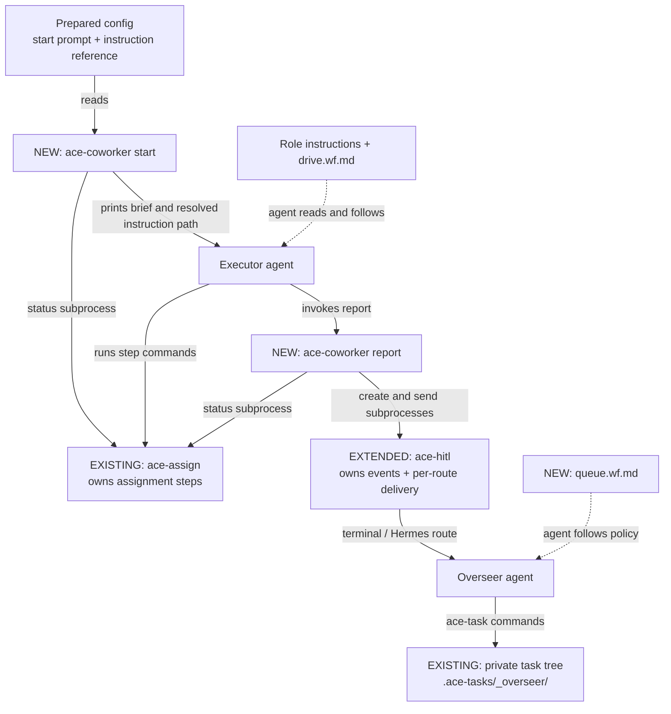
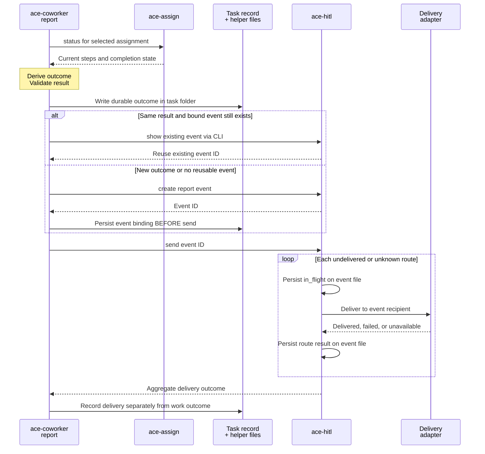

# PR #383 — prepared coworker briefs, outcome reporting, and retained HITL delivery

[Original PR](https://github.com/cs3b/ace/pull/383) · candidate `579ea35916a56fe980687e0c9612a559b65f64b3` · 170 files, +11,206 / −170.

**Change:** introduces `ace-coworker` start/status/report/resume around existing assignments; extends HITL with report events, addressing, configurable delivery and retry retention; adds overseer queue instructions and lab/runtime status views.

**Execution boundary:** `ace-coworker start` validates prepared inputs and prints a brief. It does not launch an LLM or execute the assignment. The agent reads the resolved Markdown instructions and runs the assignment commands. The new queue workflow is likewise an agent process, not a scheduler implementation.

Dashed arrows mean Markdown instructions followed by an agent. Solid arrows mean execution or data transfer, as labeled. Route delivery depends on the configured adapter supporting the event recipient; an unsupported destination is refused.

The start prompt may be inline or loaded from a configured file. Protocol instruction references resolve through `ace-nav`; the brief carries the source path. This is prompt preparation and handoff, not a hidden model call. [Start implementation](https://github.com/cs3b/ace/blob/579ea35916a56fe980687e0c9612a559b65f64b3/ace-coworker/lib/ace/coworker/organisms/start_orchestrator.rb#L26), [instruction resolution](https://github.com/cs3b/ace/blob/579ea35916a56fe980687e0c9612a559b65f64b3/ace-coworker/lib/ace/coworker/molecules/instruction_resolver.rb#L33).

**Critical ordering: report before delivery; retain identity before send.** This detail is worth a second diagram because interruption behavior is invisible in the overview.

This shows normal reporting with delivery enabled. `--dry-run` writes nothing; `--no-send` omits transport; error policy `stop` records locally without HITL. An interrupted send leaves identity bound for retry. Delivery is at least once: the same event can reach a recipient again, so recipient-side deduplication still matters. Retrying delivery does not rerun the assignment.

| Boundary | Contract / review focus | Source or regression evidence |
|---|---|---|
| Brief → agent | Printing a ready brief is not executing or completing work. | [Start usage](https://github.com/cs3b/ace/blob/579ea35916a56fe980687e0c9612a559b65f64b3/ace-coworker/docs/usage.md#L48). |
| Outcome → delivery | Derive work result from assignment state; persist event identity before transport. A delivery failure must not change work success into execution failure. | [Report orchestrator](https://github.com/cs3b/ace/blob/579ea35916a56fe980687e0c9612a559b65f64b3/ace-coworker/lib/ace/coworker/organisms/report_orchestrator.rb#L78), [interrupted-send regression](https://github.com/cs3b/ace/blob/579ea35916a56fe980687e0c9612a559b65f64b3/ace-coworker/test/organisms/report_orchestrator_test.rb#L234). |
| HITL → routes | Honor the recipient and machine; retain independent route outcomes. Unknown delivery remains retryable; delivered routes are skipped unless forced. | [Sender](https://github.com/cs3b/ace/blob/579ea35916a56fe980687e0c9612a559b65f64b3/ace-hitl/lib/ace/hitl/organisms/hitl_sender.rb#L51), [retention tests](https://github.com/cs3b/ace/blob/579ea35916a56fe980687e0c9612a559b65f64b3/ace-hitl/test/fast/organisms/hitl_sender_retention_test.rb#L107). |
| Resume → outcome | A delivered error does not satisfy a subsequently successful assignment; report the new success. Incomplete work resumes from real assignment/Git state. | [Resume planner](https://github.com/cs3b/ace/blob/579ea35916a56fe980687e0c9612a559b65f64b3/ace-coworker/lib/ace/coworker/atoms/resume_planner.rb#L32), [error-to-success regression](https://github.com/cs3b/ace/blob/579ea35916a56fe980687e0c9612a559b65f64b3/ace-coworker/test/organisms/report_orchestrator_test.rb#L323). |
| HITL question → reply | Questions retain pending/answered semantics; reply addresses identify the originating worktree. Reports are recorded outcomes, not questions awaiting answers. | [Addressing tests](https://github.com/cs3b/ace/blob/579ea35916a56fe980687e0c9612a559b65f64b3/ace-hitl/test/fast/organisms/hitl_manager_addressing_test.rb). |
| Report → overseer decision | Match task/assignment/step and record processed event ID before acting. Worker completion does not satisfy an integration dependency. These are agent-enforced instructions. | [Queue workflow](https://github.com/cs3b/ace/blob/579ea35916a56fe980687e0c9612a559b65f64b3/ace-overseer/handbook/workflow-instructions/overseer/queue.wf.md#L27). |

**Other changed paths:** `ace-herdr status` reads live workspace/tab/pane topology; `ace-lab status` reads configuration and state-location presence and points to `ace-git-worktree list`. Neither status view drives the work. Tests, package wiring, task evidence and usage documentation complete the diff. The diagrams intentionally focus on execution and delivery; they are not a complete file inventory.

**Recorded validation:** the PR reports HITL 347 tests, Hermes 199, coworker 138, and a 52-package suite with 11,915 passed, zero failed, 41 skipped. Historical evidence and named regression tests were inspected; no package suite was rerun for this mapping exercise.
