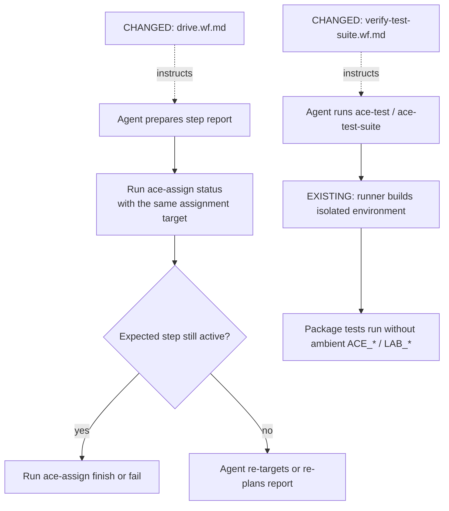

# PR #391 — check assignment state before reporting; use the hermetic test runner

[Original PR](https://github.com/cs3b/ace/pull/391) · candidate `1022b796ceff43c1d9626ddcc6ae71e7c3eba25c` · 6 files, +42 / −7.

**Change:** two Markdown workflow instructions alter how the agent uses existing commands. The PR adds no runtime guard and no environment-scrubbing implementation.

Before: the reporting instructions went from preparing a report to `finish`. After: the agent must re-read status and confirm the active step before either `finish` or `fail`. Verification guidance now explicitly requires the existing hermetic test runner.

Dashed arrows mean instructions followed by an agent. Solid arrows mean a command, result, or execution step. The two branches are separate workflow concerns, not a mandatory execution order.

| Boundary | What must hold | Review question / evidence |
|---|---|---|
| Agent → assignment CLI | Re-read status for the same target immediately before reporting; re-plan if the active step moved. | This is agent discipline, not an atomic runtime check. Do not claim it closes every status-to-write race. [Changed instruction](https://github.com/cs3b/ace/blob/1022b796ceff43c1d9626ddcc6ae71e7c3eba25c/ace-assign/handbook/workflow-instructions/assign/drive.wf.md#L760). |
| Agent → test runner | Package verification uses the sanctioned runner; no duplicate helper scrub. | Does the invoked path actually apply the existing environment policy? [Changed instruction](https://github.com/cs3b/ace/blob/1022b796ceff43c1d9626ddcc6ae71e7c3eba25c/ace-assign/handbook/workflow-instructions/assign/verify-test-suite.wf.md#L28), [existing policy](https://github.com/cs3b/ace/blob/1022b796ceff43c1d9626ddcc6ae71e7c3eba25c/ace-test-runner/lib/ace/test_runner/models/environment_policy.rb#L28). |

**Recorded validation:** the PR reports 633 tests / 2,275 assertions / zero failures or errors, plus a seeded fork-environment comparison with identical results. These historical results were read, not rerun for this diagram exercise. They support the existing runner behavior; they do not prove an agent always follows the new instruction.

**Scope:** the remaining changed files are changelog and task records. There is no new sanitizer to review.
